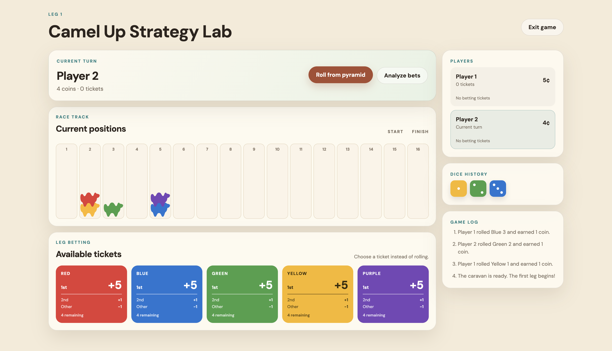
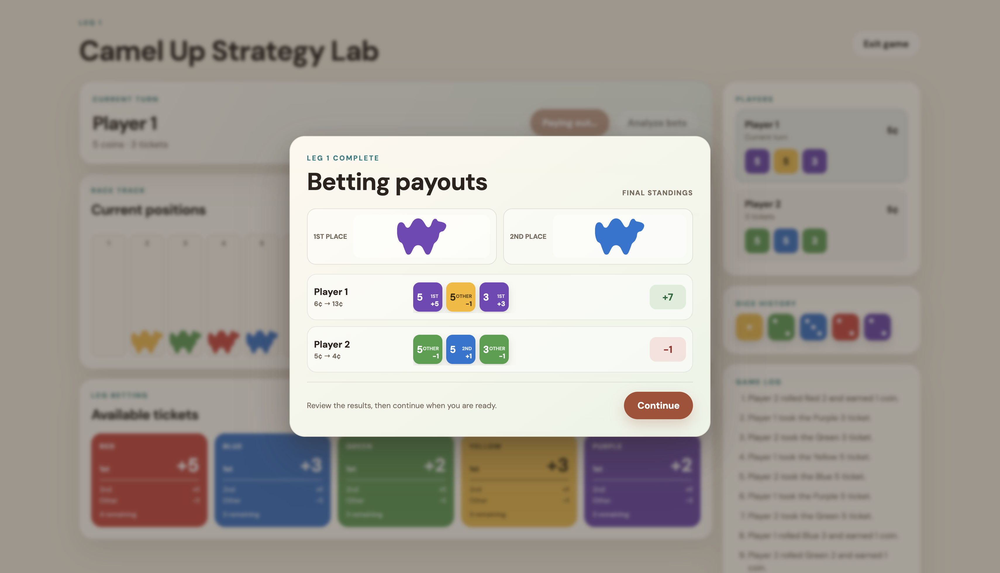
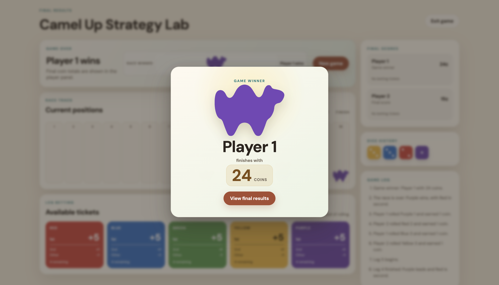

# Camel Up Strategy Lab

A full-stack **Camel Up** race simulator and betting advisor built with Python, FastAPI, React, and TypeScript.

The project models camel movement, stacking, dice rolls, leg betting, payouts, multi-leg races, and final winners. Its AI advisor evaluates the current board state, calculates first- and second-place probabilities, and ranks available betting tickets by expected value.

> Educational project inspired by the board game *Camel Up*. This repository is not affiliated with the official game or publisher.



## Highlights

- Complete multi-player race flow across multiple legs
- Correct camel stacking and stack movement
- Stack-aware, one-space-at-a-time camel animations
- Full-screen animated dice rolls
- Animated betting-ticket transfers
- Click-to-dismiss leg payout summaries
- Final race-winner celebration
- Subtle player turn transitions
- Expected-value betting analysis
- Exact enumeration of remaining die outcomes
- Monte Carlo analysis support in the Python engine
- FastAPI game API
- Responsive React and TypeScript interface
- Automated Python tests and frontend build/lint scripts

## How It Works

Each camel has a matching die with possible values of `1`, `2`, or `3`.

When a camel moves:

1. The camel advances by the rolled number of spaces.
2. Any camels stacked above it move with it.
3. The moving stack lands on top of the destination stack.
4. Rankings are recalculated from track position and stack order.

A leg ends after every available camel die has been rolled. Players are then paid according to the camels finishing first and second in that leg. The race continues through additional legs until a camel reaches or crosses the finish.

## AI Betting Advisor

The advisor analyzes the current board state and estimates the probability that each camel will finish the leg in first or second place.

### Exhaustive Enumeration

For every remaining die, the engine considers:

- which camel is rolled
- whether that die shows `1`, `2`, or `3`
- every possible ordering of the remaining rolls

Each possible continuation is simulated from a copy of the current board state. The resulting rankings are aggregated into exact first- and second-place probabilities for the current leg.

The web interface uses this enumerative analysis when the player selects **Analyze bets**.

### Monte Carlo Simulation

The Python engine also supports repeated random simulations. This provides an experimental probability estimate that can be compared with the exact enumerative result.

### Expected Value

For a ticket with value \(v\), the advisor calculates:

```text
EV = v × P(first) + 1 × P(second) - 1 × P(other)
```

where:

```text
P(other) = 1 - P(first) - P(second)
```

Available tickets are ranked from highest to lowest expected value.

## Gameplay Experience

### Dice rolls

The selected die appears in a full-screen overlay, tumbles through temporary values, reveals the actual result, and then disappears before camel movement begins.

### Camel movement

Camels move through separate one-space hops. A camel carries every camel stacked above it, while occupied intermediate spaces are treated as obstacles that the moving stack must visibly clear.

### Betting tickets

Selecting a ticket animates the full betting card into the active player's compact ticket row. The permanent board layout remains unchanged during the animation.

### Leg payouts

At the end of a leg, the interface shows:

- first- and second-place camel icons
- every player's tickets
- each ticket's payout
- each player's combined leg result

The payout screen remains visible until the player clicks **Continue**.

### Race completion

After the final payout, the winning camel and winning player are presented in a dedicated celebration. The final score screen appears after the player selects **View final results**.

## Tech Stack

### Backend

- Python
- FastAPI
- Uvicorn
- Pytest
- Colorama

### Frontend

- React
- TypeScript
- Vite
- React Router
- ESLint

## Project Structure

```text
camel-up-betting-ai/
├── AI.py                         # Probability analysis and expected value
├── Board.py                      # Track, movement, rankings, and tickets
├── CamelUp.py                    # Core game orchestration and payouts
├── Player.py                     # Player balance and betting tickets
├── Pyramid.py                    # Dice state and randomized rolls
├── web/
│   ├── app.py                    # FastAPI routes and application setup
│   └── service.py                # In-memory game sessions and serialization
├── frontend/
│   ├── src/
│   │   ├── api/                  # Backend API client
│   │   ├── components/
│   │   │   ├── betting/          # Betting cards
│   │   │   ├── board/            # Race board and movement animation
│   │   │   ├── dice/             # Die rendering
│   │   │   ├── icons/            # Approved camel SVG component
│   │   │   └── player/           # Player betting-ticket display
│   │   ├── pages/                # Setup, landing, and game pages
│   │   ├── types/                # Shared frontend data types
│   │   └── index.css             # Global layout and animation styles
│   ├── package.json
│   └── vite.config.ts
├── tests/                         # Python unit tests
├── requirements.txt
└── README.md
```

## Getting Started

### Prerequisites

Install:

- Python 3.10 or newer
- Node.js and npm
- Git

### Clone the repository

```bash
git clone https://github.com/T1makov/camel-up-betting-ai.git
cd camel-up-betting-ai
```

### Backend setup

Create and activate a virtual environment:

```bash
python3 -m venv .venv
source .venv/bin/activate
```

On Windows PowerShell:

```powershell
python -m venv .venv
.venv\Scripts\Activate.ps1
```

Install the Python dependencies:

```bash
pip install -r requirements.txt
```

Start the FastAPI server from the repository root:

```bash
python3 -m uvicorn web.app:app --reload
```

The API runs at:

```text
http://localhost:8000
```

Interactive API documentation is available at:

```text
http://localhost:8000/docs
```

### Frontend setup

Open a second terminal:

```bash
cd frontend
npm install
npm run dev
```

The Vite development server normally runs at:

```text
http://localhost:5173
```

Keep both the backend and frontend servers running while playing.

## API Endpoints

| Method | Endpoint | Purpose |
|---|---|---|
| `GET` | `/api/health` | Check whether the API is running |
| `POST` | `/api/games` | Create a game |
| `GET` | `/api/games/{game_id}` | Retrieve the current game state |
| `POST` | `/api/games/{game_id}/roll` | Roll a die and advance the race |
| `POST` | `/api/games/{game_id}/bet` | Take a leg betting ticket |
| `GET` | `/api/games/{game_id}/advice` | Calculate betting probabilities and EV |
| `POST` | `/api/games/{game_id}/next-leg` | Reset leg resources and start the next leg |

## Running the Command-Line Version

The original Python interface remains available:

```bash
python3 CamelUp.py
```

Typical actions include:

```text
r = roll a die
b = take a betting ticket
a = request AI analysis
```

## Testing and Validation

Run the Python test suite from the repository root:

```bash
python3 -m pytest
```

Run frontend linting:

```bash
cd frontend
npm run lint
```

Create a production frontend build:

```bash
npm run build
```

Preview the production build locally:

```bash
npm run preview
```

## Screenshots

### Main Game Interface


### End-of-Leg Payouts



### Game-Over Celebration



## Current Limitations

- Game sessions are stored in server memory and are lost when the backend restarts.
- The interface does not currently support remote real-time multiplayer.
- Overall race winner/loser betting is not implemented.
- Spectator tiles are not implemented.
- Monte Carlo analysis is supported by the Python engine but is not exposed as a separate web-interface mode.
- The current engine models the five primary racing camels supported by this project.

## Possible Extensions

- Persistent game storage
- Remote multiplayer rooms
- Overall winner and loser betting
- Spectator tile placement
- Probability charts that update after every roll
- Side-by-side enumeration and Monte Carlo comparisons
- AI-controlled players and strategy tournaments
- Deployment of the API and frontend
- End-to-end browser tests

## Design Goals

The interface intentionally uses:

- flat two-dimensional camel pieces
- the official five camel colors
- a warm desert-inspired palette
- a single consistent sans-serif typeface
- animation that explains game state changes without redesigning the board
- reduced-motion fallbacks for accessibility

## License and Attribution

This is an educational programming project inspired by *Camel Up*. It is not affiliated with, endorsed by, or sponsored by the official game or its publisher.
